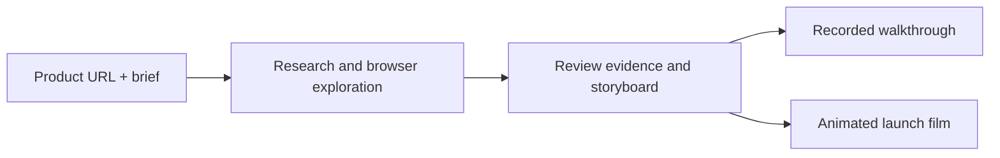

<div align="center">


# App2Reel

**Turn a product URL and a brief into a narrated demo and an animated launch film.**

[](LICENSE)
[](docs/installation.md)
[](https://github.com/jntv/app2reel/actions/workflows/ci.yml)
[](https://github.com/jntv/app2reel)

[Watch sample films](#watch-the-sample-films) · [Quick start](#get-started) · [Try the sample](#try-the-sample) · [Use your own product](#use-your-own-product) · [Voice setup](docs/voices.md#set-up-natural-voices) · [Troubleshooting](docs/installation.md#troubleshooting)

[Full installation guide](docs/installation.md) · [Using the studio](docs/usage.md) · [Report a bug](https://github.com/jntv/app2reel/issues/new?template=bug_report.yml) · [Contribute](CONTRIBUTING.md)

</div>

App2Reel explores a web product in a real browser, records its workflows, and helps you shape two separate films. Review the evidence, edit the story, and export MP4s with narration and subtitles.

It uses **your ChatGPT subscription through the installed Codex CLI** for AI-assisted research and planning. Browser recording, speech synthesis, and video rendering run on your laptop. No OpenAI API key is used by the app. Account access and usage limits still apply.

## Watch the sample films

Actual App2Reel exports made for **SmartSevak**, with product-themed intros/outros, narration, word-highlighted subtitles, and original background music. **Turn sound on** to hear the voice and music.

**Product walkthrough · 1 min 28 sec · landscape**

Recorded browser interactions with camera moves and pointer highlights. Light-gray privacy masks cover account and personal details in this public copy.

https://github.com/user-attachments/assets/f9e535a2-9986-466b-a1a9-bbdaa06710e0

**Launch film · 55 sec · portrait**

Animated product-inspired interfaces, kinetic headlines, depth, and transitions.

https://github.com/user-attachments/assets/f42d8c2f-7ad2-4305-9469-382d8cadd630

These samples use the optional **Designed Indian English · adult woman** voice. The default natural voice is a separate, smaller download. [Sample settings and downloads →](docs/samples.md) · [Choose a voice →](docs/voices.md)


## Two films from one exploration

| Product walkthrough | Launch film |
| --- | --- |
| Real browser footage with directed zooms, pointer highlights, narration, and captions. | Animated product-inspired interface models, kinetic headlines, transitions, and a branded ending. |
| Teach the workflow. | Tell the product story. |
| Landscape, 720p or 1080p. | Landscape or portrait, 720p or 1080p. |

Both have independent scripts and edits. Branded intros and closing invitations use your product’s colors and typography, with smooth blends into the film and a readable product URL at the end. Turn **Branded intro & outro** on or off in Film style; these beats fit inside the reviewed first and last scene durations, preserving the voice and subtitle clock. Export MP4, narration WAV/TXT, SRT/WebVTT subtitles, and storyboard JSON. The launch film uses graphics modeled on the observed product; it does not embed private screenshot pixels.

## Get started

**Start with the included sample:** install the studio, turn narration off, and export your first films. The sample needs no ChatGPT sign-in or Python. To explore your own product or add natural narration, follow the extra steps below.

**Requirements:** Git and **Node.js 22.13 or newer**. macOS and Linux are the primary environments. [Download prerequisites and check platform support →](docs/installation.md#requirements)

```bash
git clone https://github.com/jntv/app2reel.git
cd app2reel
npm install --global pnpm@11.25.0
pnpm install --frozen-lockfile
pnpm run setup
pnpm run doctor
pnpm dev
```

Open **[http://127.0.0.1:4310](http://127.0.0.1:4310)** and keep the terminal running. `setup` installs Chromium; `doctor` checks dependencies, Chromium, FFmpeg, and optional account/voice prerequisites. [Linux browser libraries](docs/installation.md#linux-browser-dependencies) · [npm alternative](docs/installation.md#npm-alternative) · [Setup help](docs/installation.md#troubleshooting)

For the sample, you can continue when `doctor` reports **Core runtime is ready**; missing Codex or natural-voice prerequisites are optional warnings.

### Try the sample

1. Click **Try a sample project**, then start exploration. The fictional Orbit app records real browser interactions without AI calls or external research.
2. Open **Your films → Film style**, turn **Spoken narration** off, and click **Save film style**. Natural narration is on by default and needs its own setup.
3. Click **Render both films**, preview them, and download the MP4s. Keep the sample's supplied storyboard; **AI editing plan** uses Codex.

### Use your own product

Install Codex and sign into your own ChatGPT account:

```bash
npm install --global @openai/codex
codex login
```

Choose **Sign in with ChatGPT**, then click **New project** in the studio and enter your product URL, brief, and feature list. Use a test account for signed-in product workflows. Each person uses their own ChatGPT account; access and usage limits apply. [Account setup and existing API-key sessions →](docs/installation.md#connect-chatgpt-for-your-own-product)

For natural narration, install **Python 3.12 or 3.13**, then run:

```bash
pnpm setup:voice
```

This installs the default Indian-English voice with a one-time model download, about **165 MB plus Python packages**. After terminal setup, refresh the studio, open **Your films → Film style**, turn **Spoken narration** on, choose the voice, click **Preview voice**, then **Save film style** before rendering. The studio also has a **Set up natural voices** button. Optional designed Qwen voices require Apple Silicon/macOS 14+. [Voice choices, platform requirements, and download sizes →](docs/voices.md)

To use an installed device voice without Python, explicitly choose **System (fallback)**; see [supported system voices](docs/voices.md).

**Next time:** run `pnpm dev` from the cloned folder. macOS users can also double-click **Start App2Reel.command** in that folder after setup. [Launcher and built-interface details →](docs/installation.md#later-launches-and-built-interface)

## How it works



1. **Describe the product.** Choose the features, audience, allowed origins, and desired film lengths.
2. **Explore real workflows.** App2Reel captures browser footage and records which features it observed. Use a test account for authenticated products.
3. **Direct the edit.** Adjust scripts, source intervals, camera framing, transitions, narration, and privacy masks.
4. **Render and share.** Create both films locally, preview them, and download the files.

[Detailed workflow and editing controls →](docs/usage.md)

## What to expect

- **Review feature coverage:** exploration targets your feature list within a step budget and the current account's permissions. Some features can remain unobserved; check the evidence before rendering.
- **Preview the voice:** pronunciation and naturalness vary with the voice and script. Some voices use estimated word-highlight timings. [Narration timing →](docs/voices.md#timing-and-rendering)
- **Review the visible action:** short recorded clips can finish in a held frame. Branded intros/outros share the first/last scene clocks and can cover part of an interaction; review their placement or turn them off in Film style.
- **Local, single-user studio:** the server binds to `127.0.0.1`; it has no multi-user authentication.
- **AI-assisted runs send context to OpenAI:** product briefs, screenshots, and visible page text can leave the machine through Codex. Raw recording and rendering stay local. [Privacy and browser boundaries →](docs/privacy.md)
- **Rendering takes time:** duration, resolution, hardware, and voice choices affect runtime. Longer films cannot create interactions absent from the recording.

## Documentation

| Guide | Contents |
| --- | --- |
| [Sample films](docs/samples.md) | Watch the finished walkthrough and launch film, with settings and downloads. |
| [Installation](docs/installation.md) | Setup, sample project, configuration, and troubleshooting. |
| [Using the studio](docs/usage.md) | Exploration, editing, masks, rendering, and exports. |
| [Local voices](docs/voices.md) | Voice packs, supported platforms, timing, and upstream licenses. |
| [Privacy](docs/privacy.md) | Data flow, credentials, sessions, and browser boundaries. |
| [Development](docs/development.md) | Architecture, commands, and verification. |
| [Codex access](docs/codex-access.md) | Authentication, isolation, and account limits. |
| [GitHub launch](docs/github-launch.md) | Topics, social preview, releases, and star tracking. |

## Follow and contribute

If App2Reel helps you tell your product's story, a star helps other people find it. Share a film you made, report a reproducible bug, or improve a workflow. [Contribution guide →](CONTRIBUTING.md)

The star badge shows the current public total. The [Repository stats workflow](https://github.com/jntv/app2reel/actions/workflows/repo-stats.yml) saves daily dated counts as Actions summaries and JSON artifacts retained for 90 days. It starts after the workflow is enabled; it does not reconstruct earlier history. [Tracking details →](docs/github-launch.md#stars-and-launch-feedback)

Report security issues through the [security policy](SECURITY.md). Release notes are in the [changelog](CHANGELOG.md).

## License

App2Reel's own source is [MIT licensed](LICENSE). Third-party libraries, speech runtimes, and models retain their own licenses, including GPL components in the optional speech stack. Keep downloaded runtimes/models out of the source repo and follow their terms when redistributing them. [Dependency notices and provenance →](docs/voices.md#dependency-licenses)
