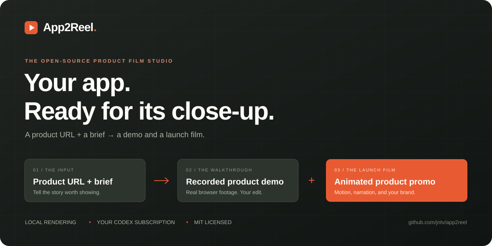
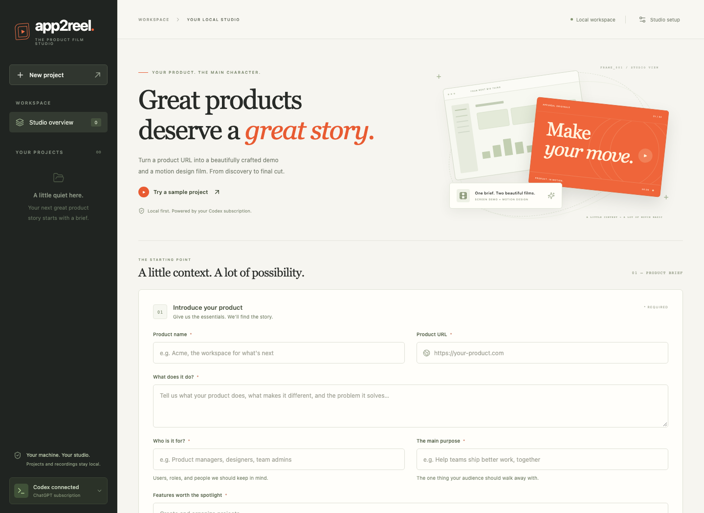
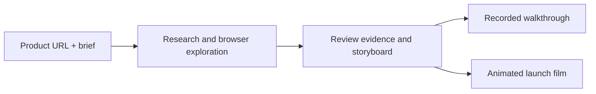

<div align="center">



# App2Reel

**Turn a product URL and a brief into a narrated demo and an animated launch film.**

[](LICENSE)
[](docs/installation.md)
[](https://github.com/jntv/app2reel/actions/workflows/ci.yml)
[](https://github.com/jntv/app2reel)

[Get started](#get-started) · [How it works](#how-it-works) · [Voice setup](docs/voices.md) · [Contribute](CONTRIBUTING.md)

</div>

App2Reel explores a web product in a real browser, records its workflows, and helps you shape two separate films. Review the evidence, edit the story, and export MP4s with narration and subtitles.

It uses **your ChatGPT subscription through the installed Codex CLI** for AI-assisted research and planning. Browser recording, speech synthesis, and video rendering run on your laptop. No OpenAI API key is used by the app. Account access and usage limits still apply.



## Two films from one exploration

| Product walkthrough | Launch film |
| --- | --- |
| Real browser footage with directed zooms, pointer highlights, narration, and captions. | Animated product-inspired interface models, kinetic headlines, transitions, and a branded ending. |
| Teach the workflow. | Tell the product story. |
| Landscape, 720p or 1080p. | Landscape or portrait, 720p or 1080p. |

Both have independent scripts and edits. Export MP4, narration WAV/TXT, SRT/WebVTT subtitles, and storyboard JSON. The launch film uses graphics modeled on the observed product; it does not embed private screenshot pixels.

## Get started

**Requirements:** Git and **Node.js 22.13 or newer**. macOS and Linux are the primary environments; optional designed voices require Apple Silicon/macOS 14+. See [platform and voice requirements](docs/installation.md#requirements).

```bash
git clone https://github.com/jntv/app2reel.git
cd app2reel
npm install --global pnpm@11.25.0
pnpm install --frozen-lockfile
pnpm run setup
pnpm run doctor
pnpm dev
```

Open **[http://127.0.0.1:4310](http://127.0.0.1:4310)**. `setup` installs Chromium; `doctor` explains missing prerequisites. Linux may need browser system libraries. [Full installation and npm alternative →](docs/installation.md)

**Try it before connecting an account:** click **Try a sample project**, then start exploration. The fictional Orbit app exercises real browser recording and rendering without AI calls or external research. Before rendering, open **Your films → Film style**, turn **Spoken narration** off, and **Save film style**. The default natural voice otherwise requires the separate [voice setup](docs/voices.md).

**For your own product:** [install Codex and sign in with ChatGPT](docs/installation.md#connect-chatgpt-for-your-own-product), then enter your product URL and brief. You can also connect from the studio. Each person uses their own account. API-key Codex sessions must be switched explicitly in the terminal.

For natural narration, install Python 3.12 or 3.13 and run `pnpm setup:voice`. This downloads the selected speech model once; subsequent speech generation runs locally. [Voice choices and download sizes →](docs/voices.md)

## How it works



1. **Describe the product.** Choose the features, audience, allowed origins, and desired film lengths.
2. **Explore real workflows.** App2Reel captures browser footage and records which features it observed. Use a test account for authenticated products.
3. **Direct the edit.** Adjust scripts, source intervals, camera framing, transitions, narration, and privacy masks.
4. **Render and share.** Create both films locally, preview them, and download the files.

[Detailed workflow and editing controls →](docs/usage.md)

## What to expect

- **Early release:** browser exploration can miss features. Inspect the evidence and the resulting films.
- **Local, single-user studio:** the server binds to `127.0.0.1`; it has no multi-user authentication.
- **AI-assisted runs send context to OpenAI:** product briefs, screenshots, and visible page text can leave the machine through Codex. Raw recording and rendering stay local. [Privacy and browser boundaries →](docs/privacy.md)
- **Rendering takes time:** duration, resolution, hardware, and voice choices affect runtime. Longer films cannot create interactions absent from the recording.

## Documentation

| Guide | Contents |
| --- | --- |
| [Installation](docs/installation.md) | Setup, sample project, configuration, and troubleshooting. |
| [Using the studio](docs/usage.md) | Exploration, editing, masks, rendering, and exports. |
| [Local voices](docs/voices.md) | Voice packs, supported platforms, timing, and upstream licenses. |
| [Privacy](docs/privacy.md) | Data flow, credentials, sessions, and browser boundaries. |
| [Development](docs/development.md) | Architecture, commands, and verification. |
| [Codex access](docs/codex-access.md) | Authentication, isolation, and account limits. |
| [GitHub launch](docs/github-launch.md) | Topics, social preview, releases, and star tracking. |

## Follow and contribute

If App2Reel helps you tell your product's story, a star helps other people find it. Share a film you made, report a reproducible bug, or improve a workflow. [Contribution guide →](CONTRIBUTING.md)

The star badge shows the current public total. The [Repository stats workflow](https://github.com/jntv/app2reel/actions/workflows/repo-stats.yml) saves daily dated counts as Actions summaries and JSON artifacts retained for 90 days. It starts after the workflow is enabled; it does not reconstruct earlier history. [Tracking details →](docs/github-launch.md#stars-and-launch-feedback)

Report security issues through the [security policy](SECURITY.md). Release notes are in the [changelog](CHANGELOG.md).

## License

App2Reel's own source is [MIT licensed](LICENSE). Third-party libraries, speech runtimes, and models retain their own licenses, including GPL components in the optional speech stack. Keep downloaded runtimes/models out of the source repo and follow their terms when redistributing them. [Dependency notices and provenance →](docs/voices.md#dependency-licenses)
